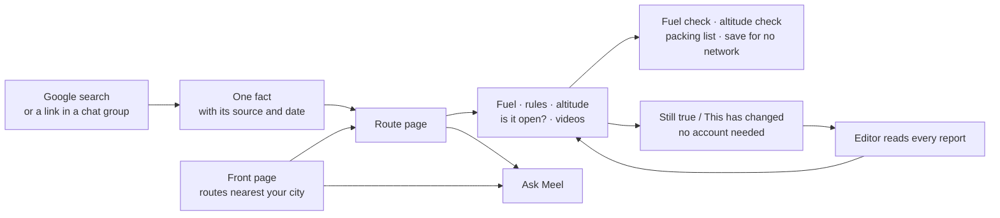
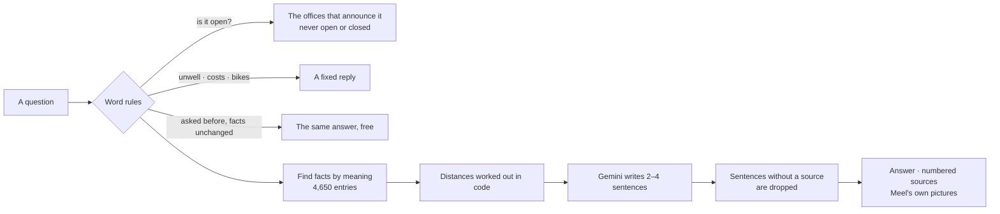
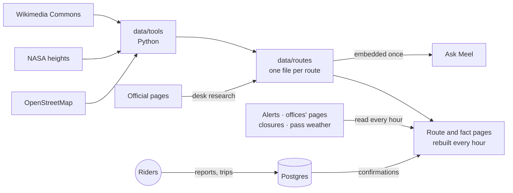

<div align="center">


<br>

**51 Indian motorcycle routes. Every fact dated and sourced. Ask it anything.**

<br>

[](https://nextjs.org)
[](https://react.dev)
[](https://www.typescriptlang.org)
[](https://tailwindcss.com)
[](https://www.prisma.io)
[](https://authjs.dev)
[](https://vercel.com)
[](#ask-meel)
<br>
[](https://rideplanner.in)
[](#how-far-to-trust-it)
[](#the-rules-it-keeps)
[](#licence)

**[Open rideplanner.in](https://rideplanner.in)** · [How riders use it](#how-riders-use-it) · [Ask Meel](#ask-meel) · [Where facts come from](#where-the-facts-come-from) · [Run it](#run-it) · [Meel in detail](docs/meel-in-detail.md)

</div>

<br>

<p align="center">
  
</p>

> [!IMPORTANT]
> **Meel is early.** Every fact was gathered at a desk from official and published sources. No rider has confirmed one yet, so read each as a lead and look at its date.

## How riders use it



<p align="center">
  
</p>

## Ask Meel

Ask in English, Hindi or Hinglish. The answer comes only from Meel's facts, with a number on every sentence that opens its source.

<p align="center">
  
</p>



<p align="center">
  
</p>

<sub>10 questions a day without an account, 40 with one. About one paisa a question. Code in [`web/src/server/ask`](web/src/server/ask).</sub>

## Where the facts come from



<sub>Facts live in files, so every change to one is a change you can read in git. The database holds only what riders create.</sub>

## Run it

Node.js 22.13+, pnpm 9 and Postgres 14+.

```bash
git clone https://github.com/vishalmeena2211/meel.git && cd meel/web
```

```bash
pnpm install
```

```bash
createdb meel && pnpm db:migrate
```

```bash
echo "AUTH_SECRET=$(openssl rand -base64 32)" >> .env.local
```

```bash
pnpm dev
```

Open http://localhost:3000. Settings, Google login and Ask Meel's setup: [`web/README.md`](web/README.md).

## In this repository

| Folder | What is in it |
|---|---|
| [`web/`](web) | The website and Ask Meel |
| [`data/`](data) | 51 routes, every fact with its source ([`data/README.md`](data/README.md)) |
| [`design/`](design) | Wireframes: one frame per situation, with build notes |
| [`docs/`](docs) | The plan, audits, and [Meel in detail](docs/meel-in-detail.md) |

## Roadmap

- [x] 51 routes, every fact dated and sourced
- [x] Fuel, altitude and packing checks; save for no network
- [x] Official alerts, offices' dates, closures and pass weather, read every hour
- [x] Reports, trips board and the editor's desk
- [x] Ask Meel (19 October 2026); light and dark
- [ ] Riders confirming the facts
- [ ] A privacy notice on the site
- [ ] Password reset, phone login, automatic tests

## Contributing

**Ride a road Meel covers?** Press "Still true" or "This has changed" on any fact. No account needed.
**Code or data?** Read [`CONTRIBUTING.md`](CONTRIBUTING.md). Security problems go to [`SECURITY.md`](SECURITY.md), not issues.

## Credits and licence

Map data © [OpenStreetMap contributors](https://www.openstreetmap.org/copyright) · heights from NASA SRTM · weather from [Open-Meteo](https://open-meteo.com) · alerts from [NDMA SACHET](https://sachet.ndma.gov.in) · pictures from [Wikimedia Commons](https://commons.wikimedia.org), credited beside each. The full list is in [Meel in detail](docs/meel-in-detail.md#credits).

Code: [MIT](LICENSE). Data keeps its sources' licences: [`data/LICENSE.md`](data/LICENSE.md).

<br>

<div align="center">
<sub>Made in India, for riders. Meel never says a road is open.</sub>
</div>
