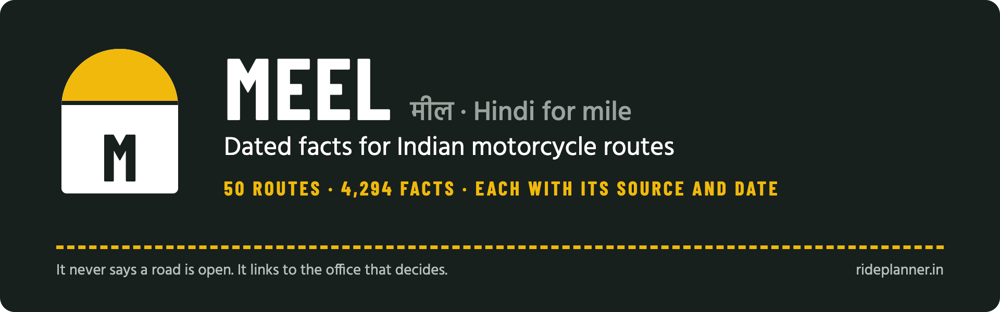
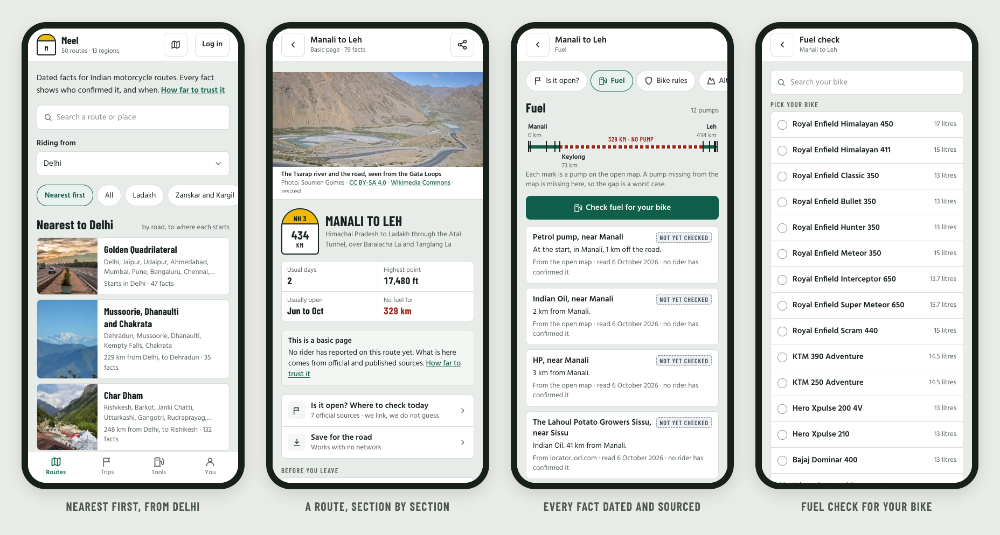
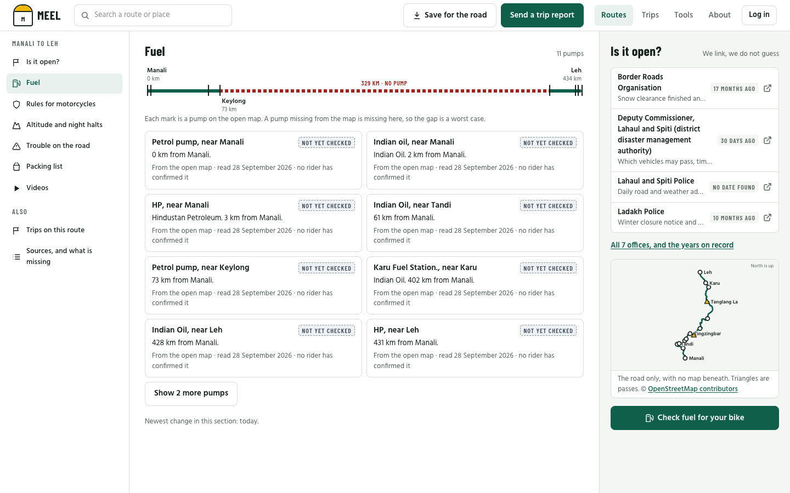
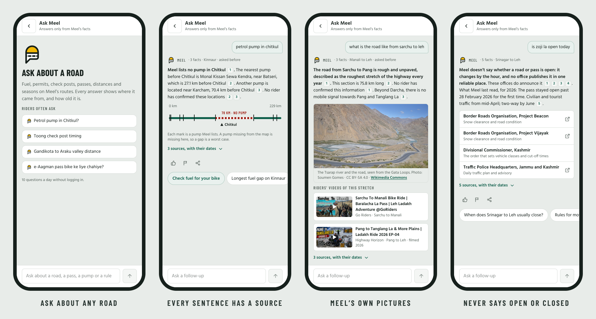
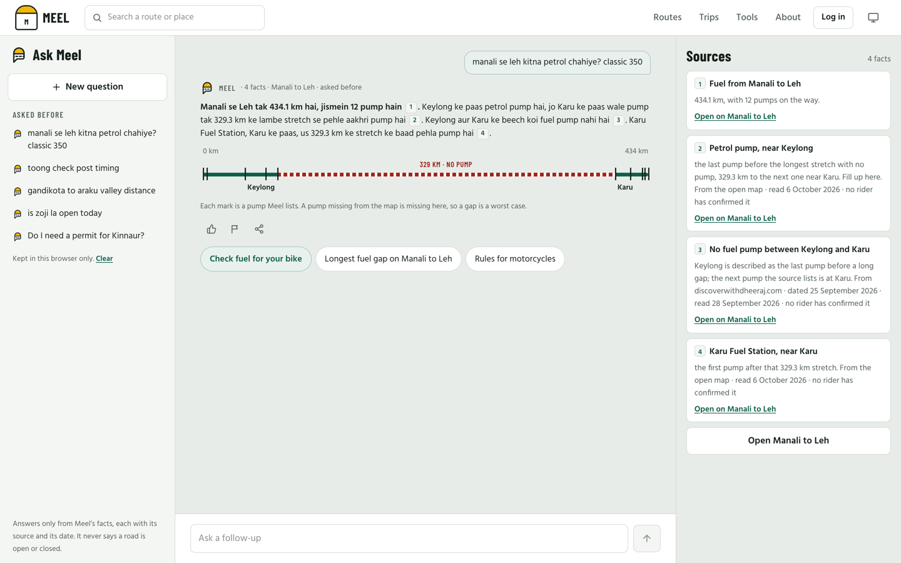
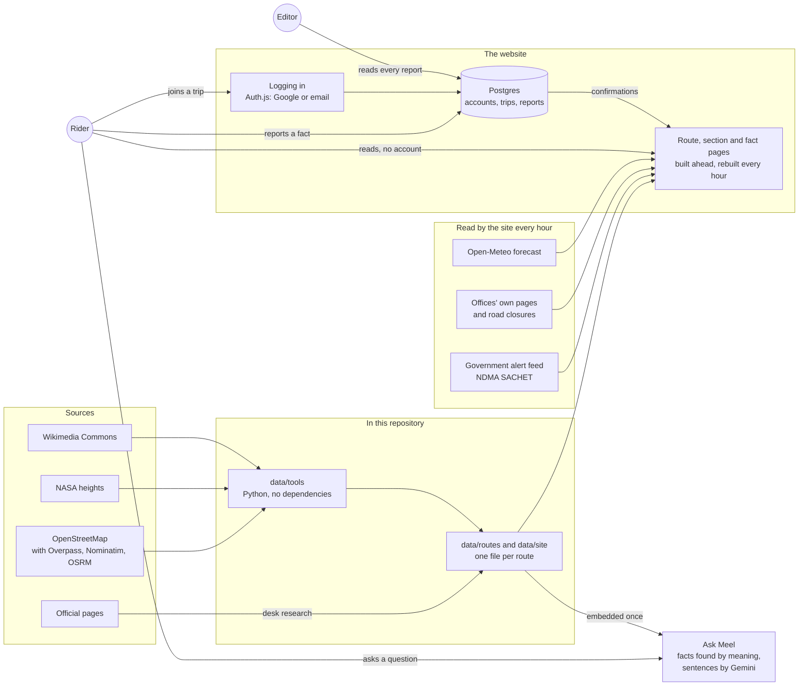

<div align="center">



<br>

**Fuel gaps, permits, passes and night halts for 51 Indian motorcycle routes.<br>Every fact shows where it came from, and the day it was last confirmed. Ask Meel answers from them.**

<br>

[](https://nextjs.org)
[](https://react.dev)
[](https://www.typescriptlang.org)
[](https://tailwindcss.com)
[](https://www.prisma.io)
[](https://authjs.dev)
[](https://vercel.com)
[](#ask-meel)
<br>
[](https://rideplanner.in)
[](#how-far-to-trust-it)
[](#the-rules-it-keeps)
[](#licence)

**[Open rideplanner.in](https://rideplanner.in)** · [What it does](#what-it-does) · [Ask Meel](#ask-meel) · [How far to trust it](#how-far-to-trust-it) · [How it works](#how-it-works) · [What the live site counts](#what-the-live-site-counts) · [Run it yourself](#run-it-on-your-machine) · [Contributing](CONTRIBUTING.md)

</div>

<br>

<p align="center">
  
</p>

## Why Meel

Every riding season, the same questions come up in every riders' chat group. Does the pump at Tandi have fuel? Has Baralacha La opened to motorcycles yet? Do I need a permit for this road? How long should I rest before Khardung La?

Someone answers from memory. The answer scrolls away, and next year the question is asked again. Worse, the answer is often out of date. Advice about Rohtang Pass still circulates years after the Atal Tunnel opened in October 2020 and made it unnecessary for the Manali to Leh road.

Meel is the memory those groups don't have. It keeps **one page per route**, split into sections: fuel, permits and rules, whether a pass is open, altitude, mechanics, network and where to stay. **Every fact carries its source and a date.** A fact that has not been checked for a while says so, in plain words, before anyone relies on it.

*Meel* (मील) is Hindi for *mile*, as in the kilometre stones beside every Indian road. The stone is the logo.

## What it does

| | |
|---|---|
| **51 routes, section by section** | From Manali to Leh and the Spiti circuit to the Konkan coast and the North-East: 13 regions and about 31,000 km of road. The highest point on any route is Umling La, at 19,030 ft. Heights are given in feet, as pass signboards give them. |
| **Every fact dated and sourced** | 4,515 facts, each with its source, the day it was read, and a state: fresh, ageing, stale, not yet checked, or riders disagree. |
| **Riding from your city** | Pick Delhi, Chandigarh or ten other cities once, and every route says how far its start is by road, nearest first. Each route's "Getting there" gives the towns on the way, the ride back, and links to open the road in a map app. |
| **Fuel check** | Pick your bike, and the route says where your tank runs short and how much extra to carry. |
| **Altitude check** | Choose where you will sleep, and the route warns you if a night climbs too fast for your body to cope. |
| **Packing list** | What to carry for that route in that month. |
| **"Is it open?" without guessing** | Meel never says a road is open. It links to the office that decides, and to where that office announces it. |
| **Reports with no account** | Anyone can say "still true" or "this has changed". The editor reads every report before it changes a fact. |
| **Trips board** | Post a trip, ask to join one, and the leader decides. The chat group link is shown only to riders the leader has accepted. |
| **Ask Meel** | Ask in English, Hindi or Hinglish, and get an answer built only from Meel's facts, with a source number on every sentence. See [Ask Meel](#ask-meel). |
| **Share a single fact** | Every fact has its own address and preview card, so the answer to a chat group's question is one link, with its date written on it. |
| **Save for the road** | Keep a route on your phone for the stretches with no network. A report made offline is sent when the signal returns. |

<p align="center">
  
</p>

## Ask Meel

Riders type questions, not names: "petrol pump in chitkul", "toong check post", "gandikota to araku valley distance". [Ask Meel](https://rideplanner.in/ask) answers them from Meel's own facts and nothing else. Every sentence carries a number that opens the fact it came from, with its source and its date.

<p align="center">
  
</p>

- **Only Meel's facts.** All 4,650 facts and notes are searched by meaning, so "kitna petrol" finds the fuel facts. If Meel has no fact, it says so and shows the closest ones it has.
- **Numbers worked out in code.** Distances to pumps, between places and between night halts are counted from the route data. The model only writes the sentences, and a sentence without a real source number is dropped.
- **Never "open" or "closed".** Asked whether a road or pass is open, it lists the offices that announce it, as the route pages do. Feeling unwell at height, costs and bike rankings get fixed replies, with no model involved.
- **Meel's own pictures.** The fuel gap drawn to scale, the route photo with its credit, riders' videos of the stretch, a table of stretches. No AI-made pictures.
- **Ten questions a day** without an account, forty with one. An answer is given again, free, while the facts behind it read the same. A question costs about one paisa.
- **Asked from anywhere.** An Ask icon in the phone's top bar on the front page and every route page, an Ask Meel button on a laptop, the search box, and a row on each route page. An opened fact can start a question about itself.

<p align="center">
  
</p>

## The rules it keeps

- **It never says a road is open.** One person cannot keep daily road status true, so Meel links to the office that decides.
- **Every fact has a date, and a source.** Nothing shows as confirmed until a rider or the editor has confirmed it.
- **Every "today" is India's calendar day**, on the server and on the phone.
- **Reading, and reporting a fact, never need an account.** Joining or posting a trip does, because a leader needs to know who is asking.
- **Credit is given where it is due.** The map data, the heights and every picture are credited on the page that uses them.
- **Kept by one person, as a hobby.** No advertising and no paid listings. If that ever changes, every paid link will be marked as such.

## How far to trust it

> [!IMPORTANT]
> **Meel is early.** Every fact was gathered at a desk, from official and published sources, in September and October 2026. **No rider has confirmed any of it yet**, which is why the screens above say "not yet checked". Riders' reports are what will turn these pages into something to rely on. Until then, treat each fact as a lead to check, and look at its date.

The site has been live at **[rideplanner.in](https://rideplanner.in)** since 8 October 2026. Every fact there has two buttons, "Still true" and "This has changed", and neither needs an account.

## How it works



Routes and facts live in files, in `data/`, so every change to a fact is a change you can read in git. Pages are built ahead and rebuilt every hour, so they load fast on a weak signal. Only what riders create lives in the database: accounts, trips, requests to join, and reports.

Some things change by the hour, so the site reads them itself and shows each with the time it was read: official alerts for the districts a road crosses, the date on a few offices' own pages, Uttarakhand's list of closed roads, and a forecast for the passes, every three hours. None of it is ever turned into "open" or "closed".

The distance from twelve cities to each route's start is worked out once, by `data/tools/approaches.py`. Where the shortest road would cross into Bangladesh or Nepal, the road is sent by an Indian town instead, and the page says so.

| Part | What it uses |
|---|---|
| Website | [Next.js 16](https://nextjs.org) with the App Router, [React 19](https://react.dev), [Tailwind CSS 4](https://tailwindcss.com), TypeScript in strict mode |
| Database | Postgres through [Prisma 7](https://www.prisma.io). Live: [Neon](https://neon.tech) in Singapore, beside the site's functions |
| Logging in | [Auth.js](https://authjs.dev): Google, or an email and a password scrambled with scrypt |
| Data tools | Python, standard library only, in `data/tools/` |
| Read every hour | Each read has a time limit and never stops a page loading. Alerts are kept for half an hour, offices' pages and closures for an hour, the forecast for three |
| Counting visits | [Mixpanel](https://mixpanel.com), on its EU servers, and Vercel's own page counts. See [what the live site counts](#what-the-live-site-counts) |
| Hosting | [Vercel](https://vercel.com). Every push to `main` deploys, and database migrations run on each live build |
| Offline | A service worker keeps a saved route. Reports made offline wait on the phone |
| Ask Meel | Facts embedded with `gemini-embedding-2` (`pnpm ask:index`, only changed facts are sent again) and searched in memory; answers written by Gemini 2.5 Flash-Lite on Vertex AI, reached from Vercel without a key. Code in `web/src/server/ask` |

## What the live site counts

rideplanner.in counts visits, so its keeper can see which routes and tools are used. In plain words:

- **Pages opened**, by their address up to the "?", and **the tools riders use**, such as the fuel check or a map app. The full list, about 40, with what each one carries, is [`web/src/lib/analytics-events.ts`](web/src/lib/analytics-events.ts). They go to Mixpanel, on its EU servers. Vercel also counts page views.
- **Screen recordings** of how pages are used: a replay of the page, not a video of the screen. Everything typed is hidden, and so are riders' names and trip chat links. Pages about an account, logging in, posting a trip and the editor's desk are never recorded.
- **Never sent:** a name, an email, a phone number, or anything typed into a box. Logged-in riders are not identified. A browser set to "Do Not Track" is not counted, and nor is a robot or a test tool.
- **Questions asked of Ask Meel** are kept for 30 days, with no phone number, account or address, to see what Meel is missing. The events about them carry the kind of question, never its words.
- **A copy you run yourself counts nothing.** Mixpanel's token comes from a setting, `NEXT_PUBLIC_MIXPANEL_TOKEN`, not from the code. Details are in [`web/README.md`](web/README.md#mixpanel).

A privacy notice on the site itself is still to come.

## Run it on your machine

You need Node.js 22.13 or newer, pnpm 9, and Postgres 14 or newer. On a Mac, Homebrew's `postgresql@16` is what this was built against.

```bash
git clone https://github.com/vishalmeena2211/meel.git && cd meel/web
```

```bash
pnpm install
```

```bash
createdb meel && pnpm db:migrate
```

```bash
echo "AUTH_SECRET=$(openssl rand -base64 32)" >> .env.local
```

```bash
pnpm dev
```

Then open http://localhost:3000. Every setting, how to add Google login, and how to make yourself the editor are in [`web/README.md`](web/README.md).

## Repository layout

| Folder | What is in it |
|---|---|
| [`web/`](web) | The website |
| [`data/`](data) | Everything the site shows, for 51 routes, with the source of every fact. See [`data/README.md`](data/README.md) |
| [`design/`](design) | The wireframes: one frame for each situation a rider can be in, with build notes under each. Open `meel-wireframes.html` in a browser |
| [`docs/`](docs) | The plan, the screen audits, and a frame-by-frame check that the site matches the drawings |

New here? Start with [`docs/plan.md`](docs/plan.md): its first part says what exists and how far to trust it.

## Roadmap

- [x] Fifty-one routes, with every fact dated and sourced
- [x] Fuel, altitude and packing checks
- [x] Official alerts, offices' own dates, road closures and pass weather, read every hour
- [x] A route file for map apps, an emergency card, and a message for someone at home
- [x] Distances from twelve cities, nearest first
- [x] Fact reports and trip reports, and the editor's desk
- [x] Trips board, with accounts through Google or email
- [x] Saving a route for no network
- [x] Open at rideplanner.in (8 October 2026), with this code public (9 October)
- [x] Ask Meel: questions answered from the facts, with sources (19 October 2026)
- [x] Light and dark, or the phone's own setting
- [ ] Riders confirming the facts: the step that matters most
- [ ] A privacy notice on the site
- [ ] Logging in with Google for everyone: while Google's consent screen is in testing, only listed accounts can
- [ ] Password reset by email
- [ ] Logging in with a phone number
- [ ] Automatic tests

## Contributing

**If you ride:** the most useful thing you can do is check a fact on a road you know. Every fact on [rideplanner.in](https://rideplanner.in) has two buttons, "Still true" and "This has changed", and neither needs an account. After a trip, a [trip report](https://rideplanner.in/report) takes about three minutes.

**If you write code or fix data:** read [`CONTRIBUTING.md`](CONTRIBUTING.md). In short: a change to a screen starts in the wireframes, a fact needs its source and a date, and the words stay plain, because the site talks to riders, not to developers.

**Found a security problem?** Please don't open an issue. [`SECURITY.md`](SECURITY.md) says how to report it privately.

Everyone here keeps to the [code of conduct](CODE_OF_CONDUCT.md): be kind, argue with sources, and keep other people's details private.

## Credits

Meel stands on other people's work, and names it:

- **Map data** © [OpenStreetMap contributors](https://www.openstreetmap.org/copyright), under the Open Database Licence: places, road lines, fuel pumps, hospitals and police stations, and the districts each road crosses. Read through [Overpass](https://overpass-api.de), [Nominatim](https://nominatim.org) and the [OSRM](https://project-osrm.org) road router, which also gives the distances from cities.
- **Heights** from NASA's Shuttle Radar Topography Mission, served by [Open Topo Data](https://www.opentopodata.org).
- **Weather at the passes** from [Open-Meteo](https://open-meteo.com), under [CC BY 4.0](https://creativecommons.org/licenses/by/4.0/).
- **Official alerts** from the government's alert feed, [NDMA SACHET](https://sachet.ndma.gov.in), in the issuer's own words.
- **District codes** from [Wikidata](https://www.wikidata.org), which is public domain.
- **Fuel pumps** missing from the map, from IndianOil's and HP's own pump locators. Each pump links to its page there.
- **Pictures** from [Wikimedia Commons](https://commons.wikimedia.org), each credited beside it, with its author and licence.
- **Fonts:** [Barlow Condensed](https://fonts.google.com/specimen/Barlow+Condensed) and [Hind](https://fonts.google.com/specimen/Hind), under the SIL Open Font Licence.

The full list, source by source, is on the site's [credits page](https://rideplanner.in/credits), and in [`data/README.md`](data/README.md).

## Licence

**The code is under the [MIT licence](LICENSE).** Use it, change it and share it, keeping the copyright notice.

**The data is not.** It keeps the licences of its sources, which cannot be changed here: map data under the Open Database Licence, heights in the public domain, and each picture under the licence named beside it. See [`data/LICENSE.md`](data/LICENSE.md).

## Words used here

| Word | What it means |
|---|---|
| **Fact** | One thing a rider needs to know, such as a pump, a permit or a pass, with its source and a date |
| **State** | How far to trust a fact today: fresh, ageing, stale, not yet checked, or riders disagree |
| **Basic page** | A route whose facts come from desk research. A **full page** also has riders' reports |
| **Section** | One part of a route page, such as fuel or rules, each on its own screen |
| **Source number** | The small number after a sentence in an Ask Meel answer. It opens the fact the sentence came from |
| **Editor** | The person who keeps Meel, reads reports, and approves a rider's first trip |

<br>

<div align="center">
<sub>Made in India, for riders. Meel never says a road is open.</sub>
</div>
